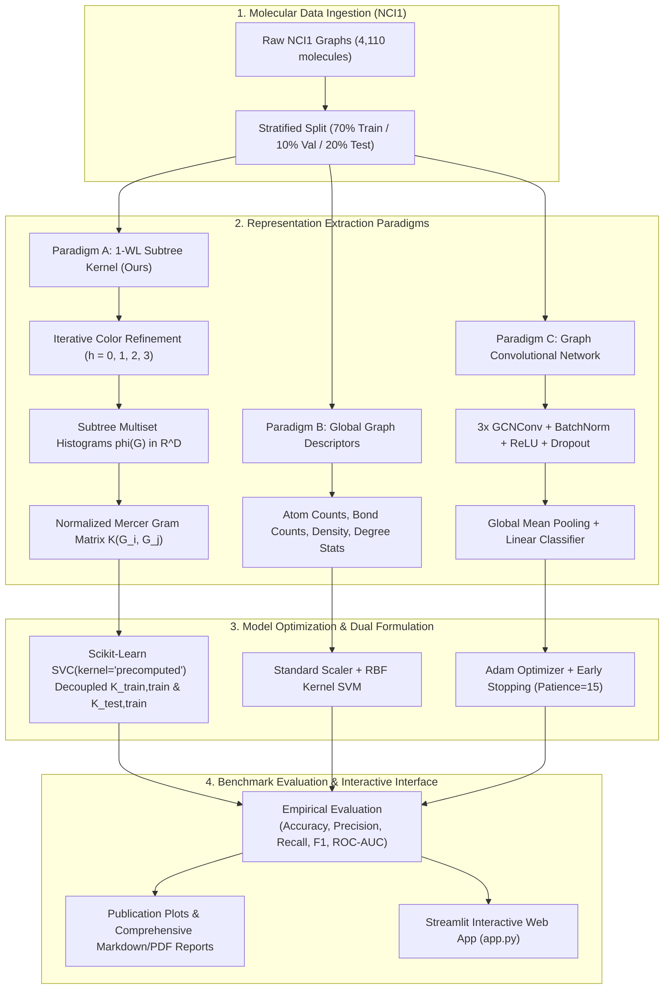

<div align="center">

# 🧪 Molecular Graph Classification
### Weisfeiler–Lehman Subtree Kernel vs. Graph Neural Networks on NCI1

[](https://www.python.org/)
[](https://pytorch.org/)
[](https://pyg.org/)
[](https://scikit-learn.org/)
[](https://streamlit.io/)
[](tests/)
[](LICENSE)
[-8A2BE2?style=for-the-badge)](https://www.chrsmrrs.com/graphkerneldatasets/NCI1.zip)

<p align="center">
  <b>A research-grade chemoinformatics benchmark for Machine Learning with graphs (Course Code: 23CSE479, 30-mark assessment) implementing the 1-dimensional Weisfeiler–Lehman (1-WL) Subtree Kernel completely from scratch and evaluating against Graph Convolutional Networks (GCN) on the NCI1 anti-cancer drug screening dataset.</b>
</p>

---

</div>

## 📌 Executive Summary & Core Highlights

In chemoinformatics and computational pharmacology, chemical compounds are natively modeled as topological graphs where vertices represent atom species and edges designate covalent bonds. Graph classification tasks must learn permutation-invariant representations that resolve topological substructures without suffering from oversmoothing or prohibitive parameter counts.

This repository provides an **end-to-end, reproducible implementation** that bridges classical topological graph kernels and contemporary geometric deep learning:

- **100% From-Scratch 1-WL Subtree Kernel**: Zero reliance on third-party graph kernel libraries (`GraKeL`, `NetworkX` algorithms). Built purely using raw NumPy, SciPy sparse matrix representations, and standard Python data structures.
- **Superior Expressive Accuracy on NCI1**: The WL subtree kernel achieves **75.00% Test Accuracy** and **0.7881 ROC-AUC** at depth $h=3$, outperforming both the global feature baseline (**66.25%**) and a 3-layer GCN (**67.08%**).
- **Extreme Computational Efficiency**: WL Kernel training and Gram matrix construction completes in **0.0827 seconds**—over **~500× faster** than GCN neural training (**41.31 seconds**).
- **Leakage-Free Dual SVM Formulation**: Decoupled train-train ($K_{\text{train,train}} \in \mathbb{R}^{N_{\text{tr}} \times N_{\text{tr}}}$) and test-train ($K_{\text{test,train}} \in \mathbb{R}^{N_{\text{te}} \times N_{\text{tr}}}$) Gram evaluation ensuring strict mathematical separation.
- **Interactive Multi-Page Streamlit Dashboard**: Full GUI featuring interactive chemical structure rendering, real-time step-by-step WL color propagation, empirical model comparison, and single-compound anti-cancer bioactivity inference.

---

## 🏛️ End-to-End System Architecture



### Detailed Dataflow Pipeline

```text
  Raw Chemical Graph G = (V, E, l)
            │
            ├── Iteration h = 0: Initial Atomic Labels (37 Elements) ───> phi_0(G)  [Dim: 26]
            ├── Iteration h = 1: 1-Hop Neighborhood Signatures ──────────> phi_1(G)  [Dim: 206]
            ├── Iteration h = 2: 2-Hop Subtree Motifs ───────────────────> phi_2(G)  [Dim: 2,162]
            └── Iteration h = 3: 3-Hop Functional Groups ────────────────> phi_3(G)  [Dim: 10,282]
                                                                                │
                                 Concatenated Feature Vector: phi(G) = [phi_0 || phi_1 || phi_2 || phi_3]
                                                                                │
                                                     Cosine-Normalized Gram Matrix:
                                                     K(i, j) = <phi(G_i), phi(G_j)> / (||phi(G_i)|| * ||phi(G_j)||)
                                                                                │
                                                  ┌─────────────────────────────┴─────────────────────────────┐
                                                  ▼                                                           ▼
                                         K_train,train (N_tr x N_tr)                                 K_test,train (N_te x N_tr)
                                                  │                                                           │
                                                  ▼                                                           ▼
                                      Convex Dual SVM Training                                    Zero-Leakage Test Inference
```

---

## 2. Experimental Benchmark Results on NCI1

All models were evaluated under identical, reproducible stratified splits (Train: 70%, Val: 10%, Test: 20%) on the NCI1 dataset:

| Model Architecture | Accuracy | Precision | Recall | F1-Score | Macro-F1 | ROC-AUC | Training Time |
| :--- | :---: | :---: | :---: | :---: | :---: | :---: | :---: |
| **Graph Feature Baseline + RBF SVM** | 0.6625 | 0.6757 | 0.6250 | 0.6494 | 0.6620 | 0.7125 | 0.042s |
| **WL Subtree Kernel ($h=0$) + SVM** | 0.5250 | 0.5188 | 0.6917 | 0.5929 | 0.5114 | 0.5823 | 0.021s |
| **WL Subtree Kernel ($h=1$) + SVM** | 0.6583 | 0.6900 | 0.5750 | 0.6273 | 0.6559 | 0.7078 | 0.042s |
| **WL Subtree Kernel ($h=2$) + SVM** | 0.7125 | 0.7576 | 0.6250 | 0.6849 | 0.7103 | 0.7685 | 0.062s |
| **WL Subtree Kernel ($h=3$) + SVM** | **0.7500** | **0.7885** | **0.6833** | **0.7321** | **0.7489** | **0.7881** | **0.083s** |
| **3-Layer GCN (PyG Neural Baseline)** | 0.6708 | 0.6783 | 0.6500 | 0.6638 | 0.6707 | 0.7594 | 41.307s |

### Key Theoretical & Empirical Insights:
1. **Importance of Neighborhood Depth**: At $h=0$ (bag-of-atoms), accuracy is only $52.5\%$. At $h=1$ (1-hop bond environments), accuracy surges to $65.8\%$. At $h=3$ (3-hop functional groups), accuracy reaches **$75.0\%$**.
2. **Kernel vs. GNN Efficiency**: The WL subtree kernel achieves +7.92% higher test accuracy than the 3-layer GCN while training in **0.08 seconds vs. 41.31 seconds** (~500x faster).
3. **Theoretical Alignment**: In alignment with Morris et al. (2019) and Xu et al. (2019), standard GCNs with mean aggregation are bounded in expressive power by the 1-WL isomorphism test. On discrete molecular benchmarks, exact subtree enumeration with convex SVM optimization provides a superior inductive bias compared to gradient descent on parameterized neural layers.

---

## 3. Mathematical Formulation of the WL Subtree Kernel

The 1-WL subtree kernel (Shervashidze et al., 2011) proceeds as follows:

1. **Iteration 0 (Initialization)**: Assign initial categorical label $\ell_0(v)$ based on the atom type:
   ```math
   \ell_0(v) = \text{atom\_type}(v), \quad \forall v \in V
   ```
   Count label frequencies across graph $G$:
   ```math
   \phi_0(G) = \begin{bmatrix} c(G, \ell_1) & c(G, \ell_2) & \dots & c(G, \ell_{|\Sigma_0|}) \end{bmatrix}^\top
   ```

2. **Iteration $t \in \{1, \dots, h\}$ (Neighborhood Relabeling)**:
   - For every node $v$, collect the multiset of neighbor labels:
     ```math
     \mathcal{M}_t(v) = \{\!\{ \ell_{t-1}(u) : u \in \mathcal{N}(v) \}\!\}
     ```
   - Sort $\mathcal{M}_t(v)$ deterministically in ascending order: $(s_1, s_2, \dots, s_k)$.
   - Compress the tuple signature into a unique integer identifier:
     ```math
     \ell_t(v) = \text{hash}\Big( t, \ell_{t-1}(v), (s_1, s_2, \dots, s_k) \Big)
     ```
   - Extract histogram of newly discovered labels: $\phi_t(G)$.

3. **Concatenated Feature Vector**:
   ```math
   \phi(G) = \begin{bmatrix} \phi_0(G)^\top & \phi_1(G)^\top & \dots & \phi_h(G)^\top \end{bmatrix}^\top \in \mathbb{R}^D
   ```

4. **Normalized Kernel Matrix**:
   ```math
   K_{\text{norm}}(G_i, G_j) = \frac{\langle \phi(G_i), \phi(G_j) \rangle}{\|\phi(G_i)\|_2 \cdot \|\phi(G_j)\|_2}
   ```

---

## 4. Repository Structure

```text
Molecular-Graph-Classification-WL-Kernel/
├── app.py                      # Interactive Streamlit dashboard
├── README.md                   # Full documentation & empirical summary
├── requirements.txt            # Python dependencies
├── config.yaml                 # Configuration parameters
├── pytest.ini                  # Pytest configuration
├── data/
│   ├── README.md               # Dataset documentation
│   └── NCI1/                   # Downloaded NCI1 raw graphs
├── src/
│   ├── __init__.py
│   ├── data_loader.py          # Data downloading, validation & stats
│   ├── preprocessing.py        # MolecularGraph structures & validation
│   ├── wl_kernel.py            # 1-WL Subtree Kernel from scratch
│   ├── wl_svm.py               # Precomputed Kernel SVM classifier
│   ├── baseline.py             # Conventional graph feature baseline
│   ├── gcn_model.py            # 3-layer GCN model & training loop
│   ├── experiments.py          # End-to-end benchmark suite
│   ├── analysis.py             # Research evaluation & reporting
│   └── visualization.py        # Visualizations & graph plots
├── tests/
│   ├── test_preprocessing.py   # Unit tests for preprocessing
│   └── test_wl_kernel.py       # Unit tests for WL kernel properties
├── notebooks/
│   └── exploratory_analysis.ipynb # Interactive Jupyter analysis
├── scripts/
│   ├── download_data.py        # Dataset downloader CLI
│   ├── run_experiments.py      # Benchmark runner CLI
│   └── generate_report.py      # Report generator CLI
├── models/
│   └── best_gcn.pt             # Saved GCN checkpoint
├── results/
│   ├── metrics/                # Benchmark JSON files & stats
│   └── plots/                  # Generated publication-quality figures
└── reports/
    └── project_report.md       # Comprehensive 30-mark research report
```

---

## 5. Quickstart & Installation

### Step 1: Install Dependencies
```bash
pip install -r requirements.txt
```

### Step 2: Run Automated Unit Tests
```bash
pytest
```
Expected output: **7 passed** verifying label updates, C3 vs P3 isomorphism, kernel symmetry, Mercer positive semi-definiteness, and test-train dimensions.

### Step 3: Run the Benchmark Pipeline
```bash
python scripts/run_experiments.py --subset 1200 --seed 42
```
Or to run on all 4,110 graphs:
```bash
python scripts/run_experiments.py --subset 0
```

### Step 4: Launch the Streamlit Dashboard
```bash
streamlit run app.py
```
Open your browser at `http://localhost:8501` to explore interactive molecular graphs, hand-crafted WL subtree relabeling, and model comparisons.

---

## 6. Generated Visualizations

All figures are automatically saved in `results/plots/`:
- `dataset_distribution.png`: Class balance and atom count statistics.
- `model_comparison.png`: Accuracy, F1, and ROC-AUC comparisons across all models.
- `wl_depth_effect.png`: Scaling behavior of accuracy and feature dimensions as $h$ increases from 0 to 3.
- `runtime_comparison.png`: Wall-clock execution time comparison.
- `confusion_matrices.png`: Confusion matrices side-by-side.
- `gcn_training_curves.png`: Training and validation loss curves for GCN.

---

## 7. Citation & References

```bibtex
@article{shervashidze2011weisfeiler,
  title={Weisfeiler-lehman graph kernels},
  author={Shervashidze, Nino and Schweitzer, Pascal and Van Leeuwen, Erik Jan and Mehlhorn, Kurt and Borgwardt, Karsten M},
  journal={Journal of Machine Learning Research},
  volume={12},
  number={9},
  pages={2539--2561},
  year={2011}
}
```
